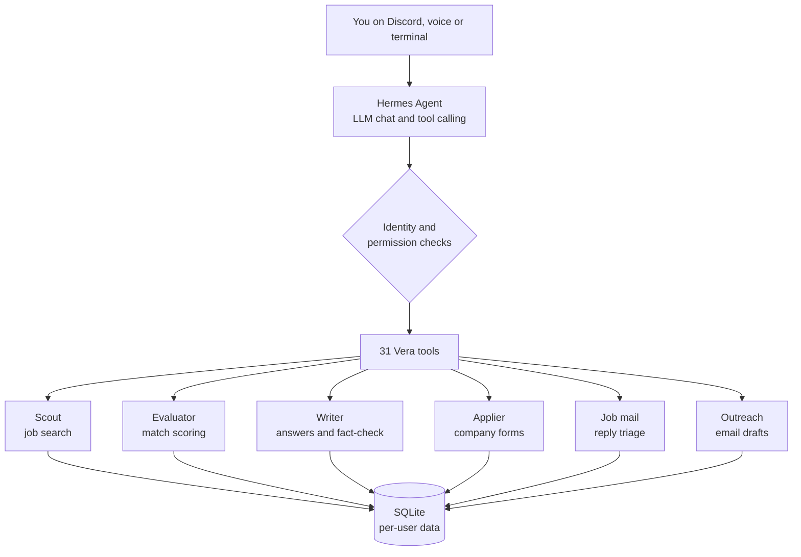
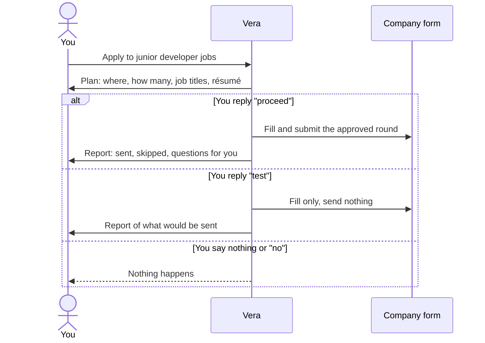

# Vera Frei

**An AI job-search agent that does the legwork and leaves the decisions to you.**

Vera finds jobs, scores them against your real profile, drafts honest applications, fills company forms and sorts employer replies. You talk to her in plain language on Discord, by text or voice. She won't start an application round or send an email until you say "proceed".


| | |
| --- | --- |
| **Agent tools** | 31, exposed to the LLM through a Hermes Agent plugin |
| **Automated tests** | About 950, including security, isolation and approval suites |
| **Running cost** | Free: free LLM tiers, free job APIs, local SQLite |
| **Interfaces** | Discord text, Discord voice, terminal |

## What she does

- **Finds jobs** from free public job APIs such as Remotive, Arbeitnow, Jobicy and Himalayas, then removes duplicates and checks that each posting is still open.
- **Scores every match** on position, level, experience, skills, education, location and salary, with reasons for and against.
- **Drafts applications** from your real profile. A fact-check step removes any sentence claiming a skill you don't have.
- **Fills company forms** on Greenhouse, Lever, Ashby and Workable with her own Playwright engine. If a form asks her to sign in, she skips it.
- **Handles email:** drafts outreach and replies, and sorts employer responses in Gmail into interviews, assessments and rejections.
- **Tracks everything:** application status, statistics, interview reminders and follow-ups.
- **Learns your rules:** corrections and preferences carry over to later conversations.

## How it works



### Nothing goes out without approval



Approval covers a whole round: after "proceed", Vera submits the forms in the plan you approved. Emails are shown in full and sent only after "proceed". Nothing runs on a schedule.

## Tools

| Area | Tools |
| --- | --- |
| **Find and assess** | `vera_find_jobs` `vera_recommend_jobs` `vera_job_details` `vera_job_state` `vera_add_job` |
| **Profile and settings** | `vera_profile` `vera_resume` `vera_preferences` `vera_settings` `vera_save_answer` |
| **Apply** | `vera_plan_applications` `vera_start_applications` `vera_stop` `vera_status` `vera_cover_letter` |
| **Track** | `vera_applications` `vera_update_application` `vera_statistics` |
| **Email** | `vera_draft_emails` `vera_manage_drafts` `vera_send_emails` `vera_reply_email` `vera_job_mail` |
| **Rules and memory** | `vera_save_rule` `vera_rules` `vera_learn` `vera_learned` `vera_note` |
| **Context** | `vera_social` `vera_other_channel` `vera_handoff` |

## Safety by design

| Risk | How Vera handles it | Where |
| --- | --- | --- |
| Someone else uses the owner's accounts | Identity check on every message and owner-only tools | `vera/hermes/identity.py` |
| One user sees another user's data | Separate profile, résumé and records per person | `tests/test_isolation.py` |
| The bot gets added to another server | Server allow-list: she leaves any other server | `tests/test_own_server_only.py` |
| The bot moderates members | Kick, ban and role changes are blocked on her connection | `vera/hermes/discord_runtime.py` |
| A web page tricks her browser into local access | Network guard blocks private addresses and `file://` | `vera/apply/netguard.py` |
| The AI invents qualifications | Fact-check removes unsupported claims | `vera/agents/writer.py` |
| An AI provider goes down | Automatic fallback across free providers | `vera/free_models.py` |

## Tech stack

- **Language:** Python
- **Agent runtime:** [Hermes Agent](https://github.com/NousResearch/hermes-agent) (third-party), extended with Vera's own plugin, tools and hooks
- **Chat:** discord.py
- **Browser automation:** Playwright with Microsoft Edge
- **LLM providers:** Gemini, Groq, OpenRouter, NVIDIA, Mistral, Cohere, Hugging Face, Cloudflare and others, all through OpenAI-compatible APIs
- **Voice:** Groq Whisper for speech-to-text, Edge TTS for speech
- **Data:** SQLite
- **Testing:** pytest and pytest-asyncio

## Project structure

```text
vera/
├── agents/      Scout, Evaluator, Writer, Applier, Job mail, Outreach
├── apply/       Form engine, site support, network guard
├── hermes/      Tools, hooks, identity checks, Discord runtime
├── bot/         Standalone Discord bot
└── sources/     Job API connectors
hermes-plugin/   Plugin manifest that loads vera/hermes
hermes-profile/  Persona and example configuration
integrations/    Optional Hermes skill for terminal chat
tests/           pytest suite
```

## Getting started

Developed and tested on Windows 11 with Python 3.14 and Microsoft Edge.

```powershell
git clone https://github.com/vincent-aaron/vera-frei.git
cd vera-frei
python -m venv .venv
.venv\Scripts\pip install -r requirements.txt
.venv\Scripts\python -m playwright install msedge
copy .env.example .env
.venv\Scripts\python -m pytest -q
```

Then add your own values to `.env`:

| Variable | Purpose |
| --- | --- |
| `DISCORD_TOKEN` | Your Discord bot token |
| `DISCORD_OWNER_ID` | Your Discord user ID |
| `DISCORD_GUILD_ID` | The one server she may join |
| `GEMINI_API_KEY`, `OPENROUTER_API_KEY` or `NVIDIA_API_KEY` | At least one free AI key |
| `OUTREACH_EMAIL`, `OUTREACH_APP_PASSWORD` | Optional: Gmail address and app password for email features |

Start the standalone bot:

```powershell
.\vera.bat
```

**To run inside Hermes Agent:**

1. Copy this folder to `%LOCALAPPDATA%\hermes\profiles\vera\app`.
2. Copy `hermes-plugin\` to `profiles\vera\plugins\vera`.
3. Copy `hermes-profile\config.example.yaml` to `profiles\vera\config.yaml` and add your own IDs.
4. Run `hermes -p vera gateway ensure`.

Don't run the standalone bot and Hermes at the same time. In the [Discord Developer Portal](https://discord.com/developers/applications), keep **Public Bot** turned off.

## Responsible use

- Vera is a personal assistant for one job seeker, not a mass-application tool. Review what she prepares and keep volumes low.
- She finds jobs through free public APIs, credits each source and links to the original listing.
- She never signs in to job boards or social networks, and she doesn't bypass CAPTCHAs or bot checks.
- The optional social-post tool reads only public search results and link previews.
- You're responsible for every application and email you approve. Check a site's terms before automating it.
- Résumés, profiles, applications and logs stay in the local `data/` folder, which is git-ignored.

## Author

Built by **Vincent Aaron Vicente**: [GitHub](https://github.com/vincent-aaron) · [LinkedIn](https://linkedin.com/in/vincent-aaron)
